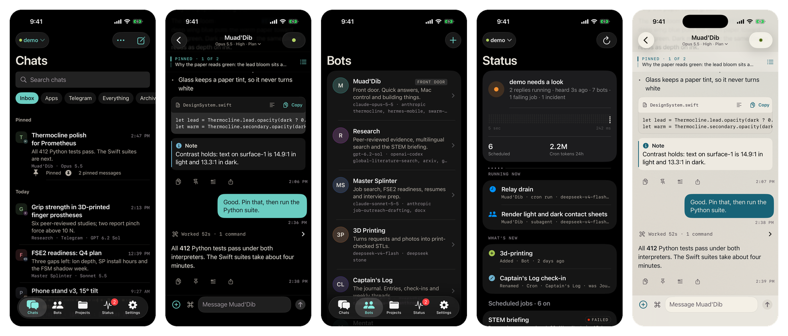
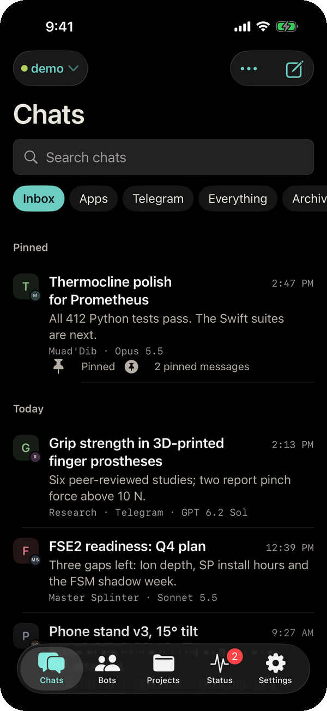
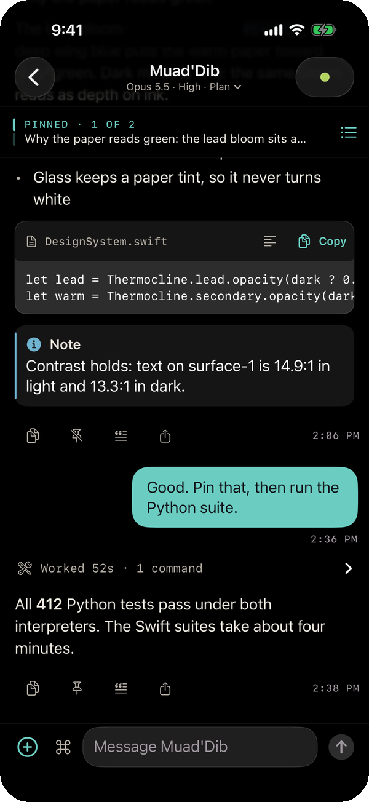
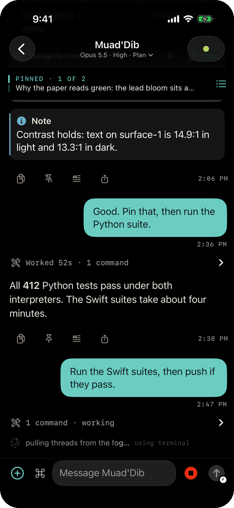
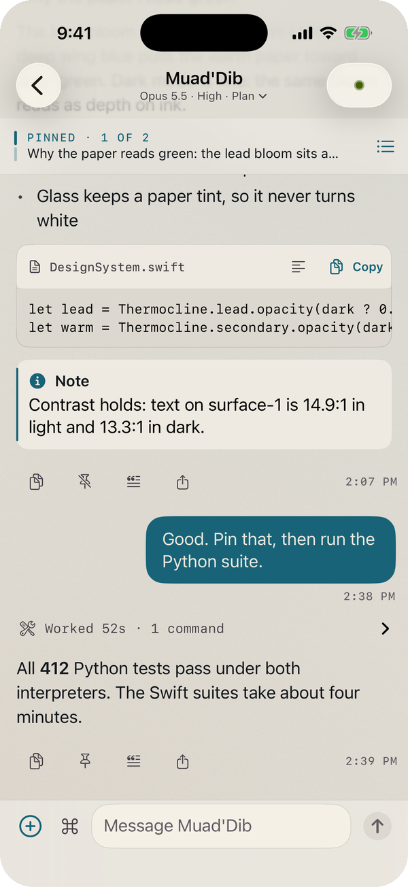
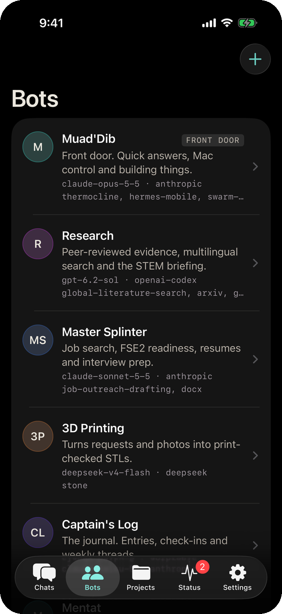
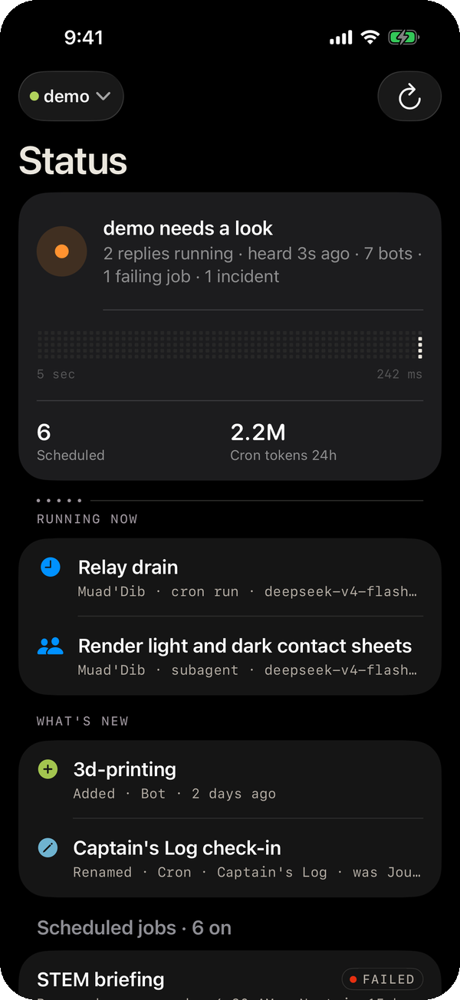
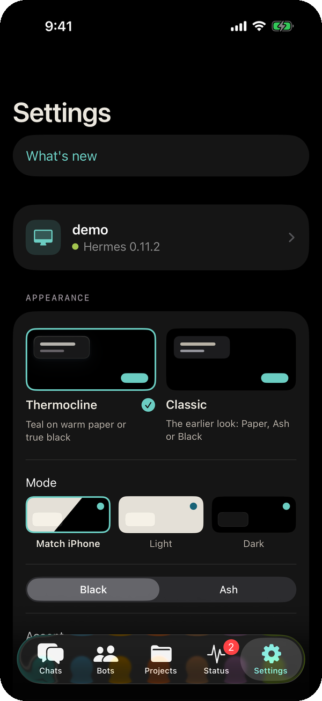
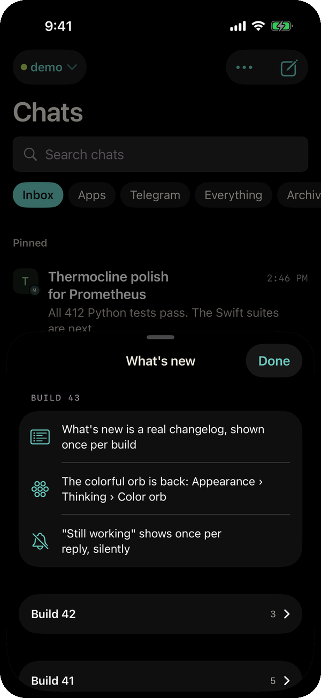

<p align="center">
  
</p>

<h1 align="center">Hermes Mobile</h1>

<p align="center">
  <b>Your <a href="https://github.com/NousResearch/hermes-agent">Hermes Agent</a>, in your pocket.</b><br>
  A native SwiftUI iPhone app for every chat, bot and run on your own computer.
</p>

<p align="center">
  
  
  
  
</p>

Pick up any conversation from the desktop app, Telegram, the terminal or a cron job, and keep going. Switch model,
provider and effort per chat, and the desktop app sees the same setting. There's no server in the middle: the app talks
to a small bridge on **your** machine over your tailnet, and every chat stays in Hermes's own `state.db`.

```
iPhone app  ──HTTPS over your tailnet──▶  Bridge on your computer (127.0.0.1:9131, exposed with `tailscale serve`)
                                             └─▶ Hermes gateway (API server + the desktop app's session protocol)
                                                   └─▶ Hermes state.db: the same chats the desktop app shows
```

**Setting it up, or asking an agent to?** Jump to [Part 2](#part-2-running-it-for-each-person-who-installs-the-app), or
follow [docs/setup.md](docs/setup.md), an ordered runbook for macOS, Linux and Windows. `Bridge/run-bridge.sh --doctor`
checks every step and prints the exact fix for anything missing.

## What it does

<table>
<tr><td width="28%"><b>Every chat, every bot</b></td><td>Desktop, phone, Telegram, CLI and scheduled runs in one list, filtered by source. Pin, archive and batch-select. Per-chat letters with a small badge for the bot, or each bot in its own color.</td></tr>
<tr><td><b>Replies you can use</b></td><td>Full Markdown: tables, callouts, checklists, code with Copy and Wrap. Select text across a whole reply, Copy as Markdown, and an action row under every finished reply.</td></tr>
<tr><td><b>Reply to several messages at once</b></td><td>Tap Reply on each message and a pill stacks up with its own answer. Delete a pill and your words stay. The sent message shows each quote with its answer.</td></tr>
<tr><td><b>Images where Hermes put them</b></td><td>A file path or <code>MEDIA:</code> tag in a reply turns into the picture, right under that line. Several become a swipeable row. Documents, audio, video and 3D open in Quick Look.</td></tr>
<tr><td><b>Model, effort and cost, honestly</b></td><td>Switch per chat from the header or with <code>/model</code> and <code>/effort</code>. The model sheet shows what you paid, what your plan covered (at API prices), each model's own share, and who wrote the last reply. After a fallback the header says so: <i>Grok 4.7 answered · Opus 5.5 next</i>.</td></tr>
<tr><td><b>Fallbacks you can see</b></td><td>Each bot's fallback chain, in order, tagged <b>Plan</b>, <b>Free</b> or <b>Paid per use</b>, so a plan running out never quietly bills an API key.</td></tr>
<tr><td><b>Messages that can't get lost</b></td><td>Send next and Guide this reply are saved on the phone first and keep one ID across retries. Take a message back (images included), guide the running reply, or retry a failed one when limits reset.</td></tr>
<tr><td><b>Watch it work</b></td><td>Playful thinking lines (tap to read the real thinking), a timestamp and duration on every tool step, and subagent cards with their goal, model, provider and steps.</td></tr>
<tr><td><b>Status, from anywhere</b></td><td>What's running, cron jobs, incidents, provider usage and resets. Restart Hermes or the bridge from the phone, now or when replies finish.</td></tr>
<tr><td><b>Notifications</b></td><td>A reply in another chat notifies even while the app is open; long-press to answer from the notification. With an APNs key on your computer, the bridge pushes when a reply is ready or Hermes needs an approval. No reply text leaves your machine.</td></tr>
<tr><td><b>Made to be lived in</b></td><td>Thermocline (true black or ash) and Classic themes, Liquid Glass, seven sprites including a swimming salmon and a flapping macaw, optional kawaii faces, and a What's new changelog once per build.</td></tr>
</table>

## Screenshots

<table>
<tr>
<td align="center"><br><sub>Chats</sub></td>
<td align="center"><br><sub>A reply, pinned and quotable</sub></td>
<td align="center"><br><sub>A live reply with tools</sub></td>
<td align="center"><br><sub>Thermocline, light</sub></td>
</tr>
<tr>
<td align="center"><br><sub>Bots and their models</sub></td>
<td align="center"><br><sub>Status</sub></td>
<td align="center"><br><sub>Themes and settings</sub></td>
<td align="center"><br><sub>What's new, per build</sub></td>
</tr>
</table>

<sub>Every screenshot comes from the app's built-in demo mode (<code>-HMDemo 1</code>): synthetic chats, no network. See <a href="#screenshots-and-demo-mode">Screenshots and demo mode</a>.</sub>

## The details

The **Projects** tab shows Hermes's own Projects, the ones you make in the desktop app's Projects view. A chat belongs to a project when it runs inside one of the project's folders (the innermost project wins), so each project lists its chats from the phone, the desktop and the CLI. **New chat in <folder>** starts a chat that works in the project's main folder; the Mac resolves the folder, the phone only names the project. These projects are read-only on the phone: rename them or change their folders on the desktop. An optional operator [project catalog](docs/project-catalog.md) can add more, with links to bots and named relative file references.

Chats are built for lifting the useful part out of a reply. The full contract, including a style guide for agents writing to the phone, is in [docs/message-format.md](docs/message-format.md).
- **Replies** run full width with real Markdown: headings, lists and checkboxes, quotes, GitHub-style callouts, tables, and code blocks with a file or language label, Wrap and Copy. Tapping `inline code` copies it. Long-press any message for Copy, Copy as Markdown, Select Text, Copy Code, Reply with Quote, Edit as New Message, Pin and Share. The left-edge swipe always goes back.
- **Files** a reply hands over with `MEDIA:/path`, or a plain path to a file in an allowed folder, show inline or open in Quick Look (documents, code, audio, video, 3D and AR). Credentials and Hermes config are never served.
- **Background work** shows as readable cards ("build.py --mesh in plate B", "2 subagent tasks finished · 1 failed"), with the exact command and output a tap away. A finished subagent shows the tokens Hermes recorded for it ("34 calls · 3.7M tokens in · 25k out · 37m03s").
- **Pinned messages** work like Telegram: a pinned bar, a list of every pin, and a chat with pins asks before it is archived.
- **Send next and Guide never get lost.** They're saved on the phone before they're sent, and keep one ID across retries so a resend never duplicates. A tray above the composer shows where each one is. Tap to edit it while it waits in Hermes's queue; touch and hold to guide the current reply now (even once it's on your Mac), move it back to the message box, or remove it.
- **The composer** stays small: `+` attaches files (also while a reply runs), ⌘ lists every command and skill, and typing `/` filters them inline. Switch model mid-chat by tapping the model chip, or type `/model`, `/model <provider>:<name>`, `/model reset` or `/effort <level>`. These never reach the agent; if a reply is running, the change applies to the next message.

The **Status** tab mirrors the status dashboard (`Status/`, a web page on port 9230): what's running right now (chats, subagents and cron runs), cron jobs, incidents, recent runs, provider usage, and a "What's new" log. At the bottom, **Restart** (owner phone only) restarts Hermes without touching the Mac. "Restart when replies finish" keeps the gateway serving and restarts it the moment nothing is running. "Restart now, stop replies" restarts it immediately. "Restart phone connection" restarts the bridge itself (`POST /m/restart {target: hermes|bridge, now}`).

Bots, including the skills each one has and its fallback chain, live on the **Bots** tab. The connection pill names the gateway (`mothership · Online`, `mothership · Degraded`) so a healthy machine is not confused with a degraded one. Both the Mac page and the phone re-discover everything on each refresh, so a bot or cron job you create shows up within seconds, with a "new" badge for a day.

**Wondering whether a message can get lost?** [docs/delivery.md](docs/delivery.md) says where every outgoing message lives and what survives an app kill, lost signal, or a bridge or gateway restart.

---

## Part 1: publishing to TestFlight (for whoever owns the Apple Developer account)

You need a paid Apple Developer Program membership, a Mac and a recent Xcode (this was built with Xcode 27.2; the
app targets iOS 17).

### 1. Set your team and bundle ID

```bash
git clone <this repo>
cd hermes-mobile/App
cp Config/Signing.xcconfig.example Config/Signing.xcconfig
```

Edit `App/Config/Signing.xcconfig`:

```
DEVELOPMENT_TEAM = ABCDE12345                 // your 10-character Team ID
HERMES_BUNDLE_ID = com.yourname.hermesmobile  // any bundle ID you own
```

`Signing.xcconfig` is git-ignored, so your team ID stays out of the repo. Everything else is set in
`App/Config/Base.xcconfig`. Nothing in the Xcode project needs editing.

### 2. Create the app in App Store Connect

In [App Store Connect](https://appstoreconnect.apple.com), go to Apps, then **+**, then New App. Choose platform iOS, any name
(for example "Hermes Mobile"), and select the same bundle ID as `HERMES_BUNDLE_ID`. If the bundle ID isn't listed yet, register it
first under Certificates, Identifiers & Profiles, then Identifiers. Xcode can also register it for you on the first archive.

If you want notifications for replies that take longer than half a minute, also turn on **Push Notifications** for this
App ID (Certificates, Identifiers & Profiles, then Identifiers, then your App ID, then Capabilities). The project already
carries the entitlement (`App/Resources/HermesMobile.entitlements`): Debug builds use the APNs sandbox, Release and TestFlight
builds use production. Xcode's automatic signing updates the provisioning profile on the next archive. The Mac side is set
up under [Push notifications](#push-notifications-optional) below.

### 3. Archive and upload

**From Xcode:** open `App/HermesMobile.xcodeproj` and choose the **HermesMobile** scheme with destination
**Any iOS Device (arm64)**. Then go to Product, Archive. In the Organizer, choose Distribute App, then App Store Connect, then Upload.

**From the command line:**

```bash
cd App
xcodebuild -project HermesMobile.xcodeproj -scheme HermesMobile -configuration Release \
  -destination 'generic/platform=iOS' -archivePath build/Hermes.xcarchive \
  -allowProvisioningUpdates CURRENT_PROJECT_VERSION=1 archive
xcodebuild -exportArchive -archivePath build/Hermes.xcarchive \
  -exportOptionsPlist ExportOptions.plist -exportPath build/export -allowProvisioningUpdates
```

**Every new upload needs a higher build number.** Bump `CURRENT_PROJECT_VERSION` in `Config/Base.xcconfig`, or pass
`CURRENT_PROJECT_VERSION=2`, `3` and so on, as in the command above. Export compliance is answered in `Info.plist`: the app uses
only standard HTTPS (`ITSAppUsesNonExemptEncryption = NO`).

### 4. Add testers

Once the build finishes processing (a few minutes to an hour), it appears under the app's **TestFlight** tab.

- **Internal testing** is available for eligible App Store Connect team members with access to the app. Assign the processed build to their internal group.
- **External testing** requires TestFlight App Review for the first build. Supply a beta description, feedback email and a reachable review setup. Use a separate demonstration gateway with synthetic chats and a working demo login for the duration of review. Include instructions for connecting and switching gateways in the review notes. Single-use codes expire after five minutes and are unsuitable as a standing reviewer login. [TestFlight test information](https://developer.apple.com/help/app-store-connect/test-a-beta-version/provide-test-information/) · [Apple’s review access guidance](https://developer.apple.com/help/app-review/before-submitting-for-review/complete-review/)

Testers install the **TestFlight** app on their iPhone and accept the invite. TestFlight builds expire after 90 days, so
upload a new one before then.

---

## Part 2: running it (for each person who installs the app)

Everyone needs their own Mac running Hermes. The app only ever talks to the address you type in.

### On your Mac

1. **Hermes Agent** installed and its gateway running (`hermes gateway run`, or however you normally run it). Tested with
   Hermes **0.23.x**. The bridge uses Hermes's internal desktop protocol, so a much older or newer Hermes may not work.
2. Hermes's API server needs a key: `API_SERVER_KEY` in `~/.hermes/.env`. Each named profile you want on the phone needs its
   own `API_SERVER_KEY` in `~/.hermes/profiles/<name>/.env`. Generate keys with `openssl rand -hex 32`.
3. A dashboard login in `~/.hermes/config.yaml`. The app signs in with it:

   ```yaml
   dashboard:
     basic_auth:
       username: you
       password: a-long-password
   ```

4. Install the bridge (a per-user launch agent on port 9131 that starts at login) and the status dashboard (port 9230):

   ```bash
   Bridge/install.sh          # macOS or Linux; each one takes --uninstall to remove it
   Status/install.sh          # then open http://127.0.0.1:9230 on the Mac
   ```

   Re-running `Bridge/install.sh` keeps every `HERMES_MOBILE_*` setting of the installed service (your environment overrides it); see [docs/setup.md](docs/setup.md).

   **New bots work on the phone automatically.** Hermes's API server refuses a bot without an `API_SERVER_KEY`, so when
   a bot appears that the gateway serves but that has never had a key, the bridge backs up its `.env` to
   `~/.hermes/backups/hermes-mobile-auto/` and adds one, once the `.env` has been unchanged for 30 s. Each bot gets this
   once only: a key you remove later stays removed. To opt one bot out, add a line `# hermes-mobile: no-key` to its
   `.env`. To turn the feature off entirely, set `HERMES_MOBILE_AUTO_KEYS=0` for the bridge.

5. Make it reachable from your phone with [Tailscale](https://tailscale.com). This is tailnet-only with a real HTTPS
   certificate, and nothing is exposed to the internet:

   ```bash
   tailscale serve --bg --https=10001 http://127.0.0.1:9131
   ```

   Your address is then `https://<your-mac>.<your-tailnet>.ts.net:10001` (run `tailscale serve status` to see it).

### On your iPhone

1. Install Tailscale, sign in to the same tailnet and keep it connected. You can leave Exit Node set to None. Use the server’s full HTTPS tailnet name and Serve port, even on cellular. The tailnet policy must allow the phone to reach that port.
2. Open Hermes Mobile and enter your address from step 5. Choose **Password** to use the dashboard credentials from step 3, or **Pairing code** to use a single-use code from the host.
3. To use another gateway, tap the server name in **Chats → Add gateway** or open **Settings → Add Gateway**. From a Tailscale address you can enter just the other machine’s name when its bridge uses the same port. Search across saved gateways from the Chats gateway picker. Once both are signed in, tapping a server under **Gateways** switches chats, status and cached history together. Each gateway has a separate device credential. [Device access and revocation](docs/device-access.md)

That's it. Your chats from the desktop app, iMessage, the terminal and scheduled runs all show up, and new chats you start
on the phone appear in the desktop app's Recents.

### Attachments

The composer's **+** menu accepts photos, the camera, video clips, and **Choose file** for anything else: an MP3, a PDF, a
text file or an archive. Files keep their original bytes and media type; the bridge stages them privately and gives the
agent the local path, so Hermes decides which tool reads them.

**Photos and files arrive as they are.** Any file type goes, and an iPhone photo arrives as its own HEIC, full size,
uploaded in 1 MiB chunks that resume after a dropped connection and are verified by SHA-256 on arrival. Models can't read
HEIC, so the Mac also makes a full-resolution JPEG copy for the model to look at, and tells Hermes where the original is.
Hermes takes at most 10 images per message as native attachments (more makes it refuse the whole message), so the first
10 ride natively and the rest are handed over by path for Hermes's vision tool: all of them arrive. Up to 20 per message.
Photos kept only in iCloud are downloaded first (three tries), and if any still can't be read the chat says how many
(*Added 13 of 15 photos. 2 couldn't be loaded.*) instead of dropping them quietly.

| Limit | Default | Set by |
|---|---|---|
| All media in one message | 128 MB | Hermes, `gateway.max_inbound_media_bytes` in `config.yaml`. The phone reads it and lowers JPEG quality first, then size, so a big batch fits instead of being refused. |
| One uploaded file | 2 GB | `HERMES_MOBILE_UPLOAD_MAX_BYTES` on the bridge |
| One photo | 50 MP | The bridge (an iPhone's 48 MP mode is 48.8 MP) |
| Native images per message | 10 | Hermes (`gateway/session_ingress_media.py`); the rest go by path |
| Small files sent inline | 50 MB per message | `HERMES_MOBILE_MEDIA_MAX_BYTES` on the bridge (256 KiB to 128 MiB) |

Against an older bridge the phone falls back: full-resolution JPEGs if the bridge has resumable uploads, otherwise photos at 2048 px, about 1 MB each.

What you attach comes back as something you can open, from either side. Photos and files sent from the phone show under the name you picked, images dropped into the desktop composer show on the phone, a long paste opens from its **Pasted N lines** message, and a voice note keeps its words and plays. Files are served from your Hermes home and the desktop app's composer folders only; one that's since been deleted leaves its name (📎 plan.pdf). Tool runs open into what they did: the skill that loaded, the command, the delegate's goal, and a failed delegate reads as failed. A background task that is still going shows **Will resume when N background tasks finish**.

### Push notifications (optional)

Without this, the phone tells you a reply is ready only if it is still following the run, which iOS allows for about thirty
seconds after you leave the app. With it, the bridge on your Mac keeps following every run and sends a push through Apple's
APNs when a reply is ready, Hermes needs an approval, or a run could not finish and the phone is no longer watching. The text
is always generic ("Your reply is ready."); no reply text, command or error leaves the Mac. If the phone is still following the run, it
posts its own notification and the push is skipped; both use one identifier per chat, so you never get two.

The bridge only needs a key from the Apple Developer account that owns the app:

1. In [Certificates, Identifiers & Profiles](https://developer.apple.com/account/resources), open **Keys**, then **+**. Name it,
   tick **Apple Push Notifications service (APNs)** and create it. Download the `AuthKey_<KEYID>.p8` file. Apple lets you download it once.
   The **Key ID** is in the file name and on the key's page. Your **Team ID** is under Membership details.
2. Make sure **Push Notifications** is enabled on the app's App ID (see Part 1, step 2), then install a build that has this version of the app.
3. Put the key on the Mac where only you can read it:

   ```bash
   mkdir -p ~/.hermes/mobile/apns && mv ~/Downloads/AuthKey_ABC123DEFG.p8 ~/.hermes/mobile/apns/
   chmod 700 ~/.hermes/mobile/apns && chmod 600 ~/.hermes/mobile/apns/AuthKey_*.p8
   ```

4. Give the bridge the key, then restart it. `install.sh` writes these into the launch agent:

   ```bash
   HERMES_MOBILE_APNS_KEY_PATH=~/.hermes/mobile/apns/AuthKey_ABC123DEFG.p8 \
   HERMES_MOBILE_APNS_KEY_ID=ABC123DEFG \
   HERMES_MOBILE_APNS_TEAM_ID=ABCDE12345 \
   HERMES_MOBILE_APNS_TOPIC=com.yourname.hermesmobile \
   Bridge/install.sh
   ```

   | Variable | Meaning |
   |---|---|
   | `HERMES_MOBILE_APNS_KEY_PATH` | Path to the `.p8` key. Required. |
   | `HERMES_MOBILE_APNS_KEY_ID` | The key's 10-character ID. Required. |
   | `HERMES_MOBILE_APNS_TEAM_ID` | Your Apple Team ID. Required. |
   | `HERMES_MOBILE_APNS_TOPIC` | The app's bundle ID. Defaults to `HERMES_BUNDLE_ID` from `App/Config/Signing.xcconfig` when you use `install.sh`, otherwise `com.example.hermesmobile`. |

5. Open the app once after the update and allow notifications. The phone sends its token to the bridge, signed with the same device grant
   it uses for everything else, and the bridge forgets it when that grant is revoked or expires.

If any of the first three is missing, push is off and nothing changes. Debug builds register with the APNs sandbox and
TestFlight/App Store builds with production; the bridge uses whichever the phone reports. The bridge needs `/usr/bin/curl` (HTTP/2, included with
macOS) and uses the `cryptography` package or `/usr/bin/openssl` to sign, so there is nothing to install. Tokens and key contents are never logged.
Tokens APNs reports as invalid (410, `BadDeviceToken`, `Unregistered`) are deleted.

### Slash commands and skills

Type `/`, or tap the `/` button, and the composer lists the commands Hermes can run from a chat (`/learn`, `/status`, `/agents`, `/compress`, and the rest that are not desktop-only). Picking one inserts it. Sending `/learn how I name plates` runs that command on the Mac; it is not handed to the model as a normal message. On a bot, **Teach a skill** writes a new skill, and tapping a skill appends a note, then Hermes rescans its skill folders.

### Finding and organising chats

**Chats** shows every conversation you can continue. **Desktop & phone** shows local and GUI sessions that Hermes attributes to those clients; **Telegram** narrows it to Telegram; **Everything** adds scheduled, one-shot,
subagent and tool runs. **Archived** holds what you put away. The **i** button beside the source picker explains each
view and every source label.

Swipe left to archive and right to pin. Tap **Select** to select several chats and archive, unarchive, pin or unpin them in one batch. The bridge fans the gateway's per-session change out in
parallel and reports any row it could not change.

---

## Project layout

| Path | What it is |
|---|---|
| `App/Sources/` | SwiftUI app (iOS 17+). `API.swift` is the client, `ChatModel.swift` holds chat and streaming state, `Views/` has the screens. |
| `App/Config/` | `Base.xcconfig` (shared settings) and `Signing.xcconfig.example` (your team and bundle ID). |
| `App/project.yml` | [XcodeGen](https://github.com/yonaskolb/XcodeGen) spec. The generated `.xcodeproj` is committed, so XcodeGen is optional. After editing `project.yml`, run `xcodegen generate`. |
| `Bridge/hermes_mobile_bridge.py` | The bridge: login tokens, merged session list across profiles, read-only state.db queries, pass-through to the gateway. |
| `Bridge/bridge_turns.py` | Runs chat turns through Hermes's gateway session protocol (the desktop app's), so any chat can be continued and model/effort switches are saved on the session. |
| `Bridge/bridge_push.py` | APNs push: decides when the phone needs telling, builds the generic payload and sends it over HTTP/2 with a cached ES256 token. Off until the APNs variables are set. |
| `Bridge/install.sh` | Installs the bridge as a launch agent. |
| `Status/hermes_status_server.py`, `Status/dashboard.html` | The status dashboard: gateway, bots, cron jobs, running agents, incidents, provider usage, and what's new. It is read-only toward Hermes; its only state is `~/Library/Application Support/hermes-status/seen.json` (what it has seen, for the "new" badges). |
| `Status/install.sh` | Installs the dashboard as a launch agent on port 9230. The bridge's `/m/status` reads it (`HERMES_STATUS_URL` overrides the address). |

### Screenshots and demo mode

Debug builds have a demo mode that answers every request from fixtures in `App/Sources/DemoServer.swift`, never the
network, so screenshots never show real chats. Launch arguments:

| Argument | Shows |
|---|---|
| `-HMDemo 1` | Demo mode on, signed in to a synthetic gateway. |
| `-HMTab 0` … `4` | Opens Chats, Bots, Projects, Status or Settings. |
| `-HMOpenChat default/demo-thermocline` | Opens the demo conversation. |
| `-HMDemoLive 1` · `-HMDemoApproval 1` · `-HMDemoDraft 1` | A reply streaming, an approval waiting, a draft in the box. |
| `-HMDemoEmpty 1` · `-HMDemoError 1` | The empty and gateway-down states. |

To retake the README set on a booted simulator:

```bash
xcrun simctl status_bar booted override --time 9:41 --batteryState charged --batteryLevel 100
xcrun simctl launch booted <bundle id> -HMDemo 1 -HMTab 0
xcrun simctl io booted screenshot docs/screenshots/chats.png
```

### Development tips

- Debug builds accept `-HMServer http://127.0.0.1:9131 -HMToken <token>` as launch arguments to skip the sign-in screen in the
  Simulator. Get a token with `~/.hermes/hermes-agent/.venv/bin/python Bridge/hermes_mobile_bridge.py --issue-token sim`.
- The bridge keeps nothing but a signing secret (`~/.hermes/mobile/secret`) and its log (`~/.hermes/mobile/bridge.log`).
  Every chat and setting lives in Hermes's own `state.db`.

- Tests: `Tests/run-swift.sh <simulator id>` runs the Swift suites; `python -m unittest discover -s Tests -p 'test_*.py'` runs the bridge suite.

The [mobile engine and beta plan](docs/mobile-engine.md) covers native Windows setup, Telegram history, gateway compatibility, recovery tests and the proposed Rust transport evaluation.
